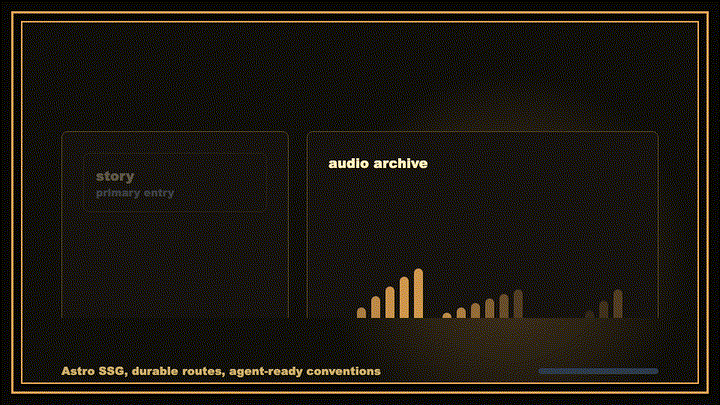

# bread.fm

<p align="center">
  
</p>

The digital archive, event ledger, flyer timeline, and radio broadcast companion for **Bread** ([bread.fm](https://bread.fm)). Built with Astro 7, Cloudflare Workers static assets, and automated SVG-to-PNG social card generation.

## Quick Start

```bash
bun install
bun run dev
```

Open [http://localhost:4321](http://localhost:4321).

## Commands

| Goal | Command | Description |
| :--- | :--- | :--- |
| Local dev server | `bun run dev` | Runs Astro with hot reloading |
| Type & asset checks | `bun run check` | Validates asset references and links |
| Lint & formatting | `bun run lint` | Biome code and style checks |
| Unit test suite | `bun test` | Vitest suite (responsive images, schemas) |
| Production build | `bun run build` | Preflight data + OG cards + Astro static build |
| Local preview | `bun run preview` | Preview production bundle in `dist/` |

## Content Architecture

Content is organized into Astro Content Layer collections defined in `src/content.config.ts`:

- **Events (`src/content/events/*.json`)**: Title, date, year, venue, lineup, status, and verification confidence (`strong`, `user-archive`, or `unverified`). Only verified events appear in the homepage chronology.
- **Archive (`src/content/archive/*.mdx`)**: Historical deep-dives, flyer scans, radio show transcripts, and event retrospectives sorted by `order`.
- **Roster (`src/content/roster/*.json`)**: Resident DJs, artists, and contributors with roles and profiles.
- **Editorial (`src/content/blog/*.md`)**: Occasional dispatch posts and journals.

## Asset & Image Optimization Pipeline

To ensure sub-second page loads without incurring external CDN costs, image processing runs at build time:

1. **Preflight Data Generation (`scripts/generate-data.mjs`)**: Compiles event ledgers and archive indexes.
2. **Social Cards (`scripts/generate-og-images.mjs`)**: Renders `src/utils/og-image-core.mjs` vector graphics into optimized 1200×630 PNGs in `public/og/` using Sharp.
3. **Responsive Images (`scripts/generate-responsive-images.mjs`)**: Resizes raw archive assets into multi-resolution WebP files served by `src/components/ResponsiveImage.astro`. Never commit raw images $>200\text{ KB}$ directly into routes.

## Deployment & Edge Runtime

- Deployed as a Cloudflare Worker using `@astrojs/cloudflare` static asset bindings (`wrangler.jsonc`).
- Deploys run from GitHub Actions on push to `main` after verifying `bun run lint` and `bun run build`.

## Agentic Workflow

- Invariants and non-negotiables: [`AGENTS.md`](./AGENTS.md).
- Content authoring skill: [`.agents/skills/static-site-author/SKILL.md`](./.agents/skills/static-site-author/SKILL.md).
